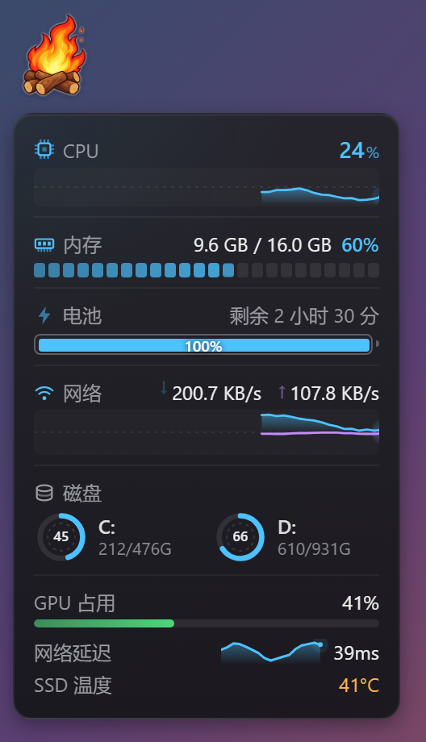
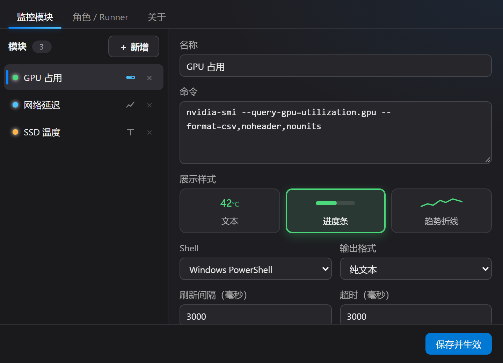
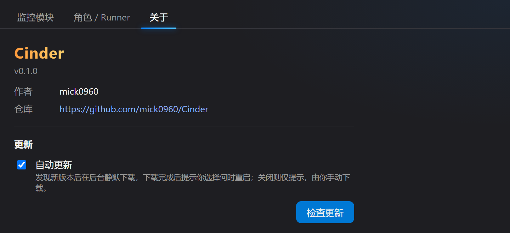

<p align="center"></p>

# Cinder

一个常驻桌面的 Windows 悬浮监控小组件：屏幕上一团会动的篝火，动画速度随 CPU 占用（也可以换成 GPU、网速或任意监控项）变化；点击展开面板，查看 CPU、内存、磁盘、网络、电池，以及你自己定义的任意监控项。

## 特性

- **悬浮篝火**：64×64 无边框透明窗口，置顶、不抢焦点、不占任务栏；默认 CPU 越忙火烧得越快，也可以改由 GPU、内存、网速或任意监控模块的数值驱动。
- **系统指标**：CPU、内存、磁盘、网络上下行、电池，点击篝火即可展开。
- **自定义监控模块**：命令（PowerShell / pwsh / cmd / 可执行文件）、HTTP 接口、Ping 延迟、GPU 占用，都能变成面板里的一行，支持文本、进度条、趋势折线三种样式。
- **模板库**：一键添加 GPU、网络延迟、公网 IP、开机时长、WSL / Docker 状态等常用模块，不用会写 PowerShell。
- **不反复启动 shell**：HTTP、Ping、GPU 是原生实现，不启动任何进程；命令也可以做成“常驻进程”，只启动一次、每输出一行刷新一次。
- **阈值着色、点击动作、导入导出**：不写 JSON 就能配置“超过 80% 变红”；点击模块行可以打开网址或运行命令；模块配置可以复制成文本分享给别人。
- **自定义角色**：用你自己的图片帧（PNG / JPG / SVG / WebP / GIF）替换篝火。
- **焚烧文件**：把文件或文件夹拖到篝火上按住 4 秒，看着它被烧成灰烬，随后移到回收站；中途移开或松手即取消。
- **系统托盘**：取消置顶后篝火被窗口盖住也能叫回来；鼠标悬停托盘图标显示当前 CPU 与内存。
- **开机自启**：在设置里一键开关，登录 Windows 后自动运行。
- **全屏自动隐藏**：玩游戏、看视频、演示时篝火自动让路，结束后自动恢复。
- **自动更新**：后台静默下载新版本，下载完成后弹出气泡，由你决定立即重启更新还是下次再说；也可以切换为手动更新。
- 低占用：面板收起时降低采样频率。

## 截图

<p align="center">
  
</p>

<p align="center">
  
  
</p>

## 安装

### 方式一：下载安装包（推荐）

1. 打开 [Releases](https://github.com/mick0960/Cinder/releases/latest) 页面。
2. 下载 `*-setup.exe` 并运行。
3. 安装后启动，屏幕上会出现一团篝火。

系统要求：Windows 10 / 11（需要 WebView2 运行时，Windows 11 和较新的 Windows 10 已自带）。

### 方式二：从源码构建

需要 [Node.js](https://nodejs.org/) 20+、[Rust](https://www.rust-lang.org/tools/install) stable，以及 [Tauri 的 Windows 前置依赖](https://tauri.app/start/prerequisites/)。

```bash
npm install
npm run tauri dev      # 开发运行
npm run tauri build    # 打包，安装包位于 src-tauri/target/release/bundle/nsis/
```

> 本地 `tauri build` 会生成更新包，需要先设置签名私钥环境变量 `TAURI_SIGNING_PRIVATE_KEY`；只想编译可执行文件时用 `npm run tauri build -- --no-bundle`。

## 使用

| 操作 | 效果 |
| --- | --- |
| 单击篝火 | 展开 / 收起监控面板 |
| 拖动篝火 | 移动位置（会记住） |
| 右键篝火 | 菜单：置顶、切换角色、设置、退出 |
| 点击面板里的模块行 | 设置了“点击动作”的模块：打开网址或运行命令（鼠标移上去会变成手型） |
| 拖文件到篝火上按住 4 秒 | 烧掉（移到回收站，可还原）；4 秒内移开或松手则取消 |
| 左键单击托盘图标 | 显示篝火并拉到最前面（取消置顶后被窗口盖住时用它叫回来） |
| 右键托盘图标 | 菜单：显示篝火、隐藏篝火、设置、退出 |
| 鼠标悬停托盘图标 | 显示当前 CPU 与内存 |

靠近屏幕右 / 下边缘时，面板会自动向左 / 向上展开。再次运行 Cinder 也会把已有的篝火显示出来并拉到最前面。

## 通用设置

设置 → **通用**：

- **开机自启**：登录 Windows 后自动运行。写入系统的“启动”项，也可以在任务管理器的“启动应用”里关闭，这里的开关会跟着反映实际状态。
- **全屏时自动隐藏**（默认开启）：检测到全屏程序、D3D 独占全屏、全屏的商店应用或演示模式时自动隐藏篝火，结束后恢复；你从托盘手动隐藏的篝火不会被自动恢复。检测基于 Windows 的 `SHQueryUserNotificationState`，不区分显示器——副屏上有全屏程序时，主屏的篝火也会隐藏。
- **篝火动画**：火苗的快慢由哪个指标决定，见下文 [篝火动画](#篝火动画)。

## 自定义监控配置

右键篝火 → **设置…** → **监控模块**：

- 点击“新增”添加一个空白模块，或点击“**模板库**”一键添加常用模块（GPU、网络延迟、公网 IP、开机时长、WSL / Docker 状态……），不用写任何命令。
- “测试运行”可以立即看到输出、数值、颜色与耗时。
- 点击“保存并生效”后立刻生效，无需重启。

### 数据来源

| 来源 | 做什么 | 启动进程？ |
| --- | --- | --- |
| **命令** | 运行 PowerShell / pwsh / cmd / 可执行文件，取其输出 | 每次刷新启动一次；勾选“常驻进程”后只启动一次 |
| **HTTP** | GET 一个网址，读取响应里的 JSON 字段 | 否 |
| **Ping** | 测量到某台主机的 ICMP 往返延迟 | 否 |
| **GPU** | 所有显卡的占用率（NVIDIA / AMD / Intel） | 否 |

> 为什么要有不经过 shell 的类型：命令型模块每次刷新都要新启动一个 powershell.exe，而模块只在面板展开时运行，启动造成的 CPU 尖峰正好会出现在面板里那条 CPU 曲线上。HTTP / Ping / GPU 完全在程序内部完成；必须用 shell 的命令请用“常驻进程”。

### 字段说明

| 字段 | 说明 | 默认值 |
| --- | --- | --- |
| 名称 | 面板里显示的标签 | — |
| 数据来源 | `命令` / `HTTP` / `Ping` / `GPU` | 命令 |
| 命令 | （命令）要执行的命令，输出（stdout）即为显示内容 | — |
| Shell | （命令）`Windows PowerShell`、`PowerShell 7 (pwsh)`、`cmd`、`直接运行程序` | PowerShell |
| 输出格式 | （命令）`纯文本` 或 `JSON` | 纯文本 |
| 常驻进程 | （命令）只启动一次，每输出一行刷新一次，见 [常驻进程](#常驻进程) | 关 |
| 网址 | （HTTP）请求地址，以 `http://` 或 `https://` 开头 | — |
| JSON 字段路径 | （HTTP）可选，留空则显示整个响应文本 | — |
| 主机 | （Ping）域名或 IPv4 地址 | — |
| 展示样式 | `文本` / `进度条` / `趋势折线` | 文本 |
| 刷新间隔 | 毫秒，最小 500（HTTP 最小 1000）；常驻进程没有这一项 | 命令 5000、HTTP 30000、Ping 3000、GPU 2000 |
| 超时 | 毫秒。命令：超时会被终止；HTTP / Ping：请求超时；常驻进程：多久没有新输出就判定卡死并重启 | 命令 3000、HTTP 5000、Ping 2000、常驻 15000 |
| 单位 | 可选，自动追加在文本后，如 `°C`、`ms`（选 Ping 时自动填 `ms`，GPU 填 `%`） | — |
| 颜色 | 可选，文本 / 进度条 / 折线的颜色 | 默认 |
| 阈值着色 | 数值高于 / 低于某个值时换颜色，见 [阈值着色](#阈值着色) | — |
| 点击动作 | 点击模块行时打开网址或运行命令，见 [点击动作](#点击动作) | — |

> 选“直接运行程序”时，命令按空格拆分为程序和参数，不经过 shell。

### 命令的输出格式

**纯文本**：命令的输出原样显示。样式为“进度条”时，输出整段需要就是一个数，支持以下写法：

- `73` 或 `73%` → 73%
- `3/4` → 75%

样式为“趋势折线”时取输出里的第一个数（`23ms` → 23），折线按历史数据自动缩放，不限于 0 ~ 100。

**JSON**：输出一行 JSON，可以动态控制文本、数值和颜色：

```json
{ "text": "73%", "value": 0.73, "color": "#ff5d5d" }
```

- `text`：显示的文字
- `value`：0 ~ 1 之间的数值，用于进度条 / 折线
- `num`：可选，自然单位下的数值（如延迟 `235`），用于阈值着色和驱动篝火；不写则取 `value × 100`
- `color`：可选，覆盖模块配置的颜色和阈值颜色

### 常驻进程

命令只启动一次、进程保持运行，**每输出一行就刷新一次**（输出格式为 JSON 时，每行一个 JSON 对象）。适合自己就会循环输出的命令：

```powershell
nvidia-smi --query-gpu=temperature.gpu --format=csv,noheader,nounits -l 2 -i 0
```

或者带循环的脚本：

```powershell
while ($true) { Get-Random -Maximum 100; Start-Sleep 2 }
```

- **只在需要时运行**：面板展开时启动；面板收起 20 秒后结束进程，再次展开时重新启动。被选作“篝火驱动”的模块除外，只要篝火显示着它就保持运行。
- **故障自动重启**：进程退出，或在“超时”（此时表示无输出超时）内一行都没有输出，会被判定为故障。面板里该行显示 `—`（悬停可看原因，包括 stderr 的第一行），随后按 2 秒、4 秒……最长 60 秒的间隔自动重启。
- **不留孤儿进程**：进程及其子进程被放进 Windows 作业对象（Job Object）。模块重载、面板收起，甚至 Cinder 崩溃或被结束时，系统都会把它们一并结束。
- **输出很密也没关系**：同一模块最多每 200 毫秒刷新一次界面。

### HTTP

发送 GET 请求并读取响应：跟随系统代理与重定向，响应最大 1 MB，所有 HTTP 模块共用连接池。**JSON 字段路径**写法：

| 路径 | 含义 |
| --- | --- |
| `ip` | 顶层字段 `ip` |
| `data.items[0].value` | 逐级取字段、数组下标 |
| `items[-1]` | 数组最后一项 |
| `$.data["key.with.dots"]` | 开头的 `$` 可省略；键名含特殊字符时用方括号加引号 |

字段是数字、字符串或布尔值时显示出来；是对象或数组时需要把路径写得更具体。路径留空则把响应正文当作文本显示（例如 `https://api.ipify.org` 直接返回 IP 文本）。

### Ping

通过 Windows 的 ICMP 接口（`IcmpSendEcho`）发送一个回显请求，显示往返毫秒数（不足 1 毫秒显示 `<1`）。不启动 ping.exe，也不需要管理员权限；目前只支持 IPv4。主机不可达、超时等情况显示 `—`，悬停可看原因。

### GPU

读取与任务管理器同源的性能计数器 `GPU Engine\Utilization Percentage`：同一个引擎在各进程上的占用相加，再取所有显卡所有引擎里最忙的那个。NVIDIA / AMD / Intel 都适用，需要 Windows 10 1709 及以上和较新的显卡驱动。采样线程只在有人读取时才运行，每次采样约 2 毫秒。

### 阈值着色

不写 JSON 也能配置“超过 80% 变红”：在模块的“阈值着色”里添加规则，数值 `高于` / `低于` 某个值时显示为指定颜色。

- **数值取自输出里的数字**：`73%` → 73，`23 ms` → 23，`4,361 MB` → 4361。HTTP 取字段里的数，Ping 是毫秒数，GPU 是百分数；JSON 输出取 `num`，没有则取 `value × 100`。
- 比较是严格的（`高于 80` 不含 80）。多条规则同时命中时，同方向的取最极端的一条（`>70` 橙、`>90` 红：95 显示红），与书写顺序无关。
- 颜色优先级：脚本用 JSON 自己给出的颜色 > 阈值规则 > 模块配置的颜色。多行条目（JSON 的 `items`）按每个条目的 `value × 100` 分别着色。

### 点击动作

点击面板里的模块行：

- **打开网址**：用系统默认浏览器打开，只支持 `http://` / `https://`。
- **运行命令**：用所选的 Shell 启动，不等待结果，图形程序会正常弹出自己的窗口（如 `taskmgr`、`wt`、`explorer D:\`）。

设置后鼠标移到那一行会变成手型；点击后该行闪一下绿色（成功）或红色（启动失败，悬停可看原因）。要执行的内容由程序按已保存的配置查找，面板页面本身无法指定命令。

### 导入 / 导出

“导入 / 导出”按钮可以把模块配置复制成文本分享给别人，也可以导入别人分享的文本：

```json
{
  "cinder": 1,
  "modules": [
    { "type": "ping", "name": "延迟", "host": "223.5.5.5", "intervalMs": 3000, "timeoutMs": 2000, "style": "sparkline", "unit": "ms" }
  ]
}
```

- 可以导出当前模块或全部模块。导出的是编辑器里的内容（含尚未保存的修改），不含 `id`。**命令或网址里如果写了密钥、令牌，它们也会被一并导出**，分享前请检查。
- 导入支持：上面这种格式、模块数组、单个模块、完整的 `config.json`（只取其中的模块），也可以直接粘贴聊天里连同说明文字一起转发的内容（自动找出 JSON 或代码块）。
- 导入前会逐条列出每个模块会做什么（命令原文、网址、主机、点击动作），可以取消勾选其中的某几个。导入的模块只是加入列表，**仍需点击“保存并生效”才会运行**。命令会在你的电脑上执行，请只导入来自可信来源的配置。
- 每个模块都经过严格检查：类型必须是已知的，长度和数值范围受限，颜色必须是 `#rgb` / `#rrggbb`，点击动作的网址必须是 http(s)；不认识的字段一律丢弃。

### 示例

**GPU 占用**：直接用模板库里的“GPU 占用”。

**NVIDIA 显卡温度（常驻进程）**

- 数据来源：命令，Shell：直接运行程序，勾选“常驻进程”，样式：趋势折线，单位：`°C`
- 命令：

```
nvidia-smi --query-gpu=temperature.gpu --format=csv,noheader,nounits -l 2 -i 0
```

**网络延迟**：数据来源选 Ping，主机填 `223.5.5.5`，样式选趋势折线，再加一条阈值规则“高于 100 ms 显示为橙色”。

**CPU 温度风格的动态颜色（JSON）**

需要在脚本里自己决定颜色时，输出格式选 JSON，样式选进度条：

```powershell
$v = Get-Random -Maximum 100
@{ text = "$v%"; value = $v / 100; color = $(if ($v -gt 80) { '#ff5d5d' } else { '#4cd97b' }) } | ConvertTo-Json -Compress
```

只想“超过某个值换颜色”时不需要这样写，用“阈值着色”即可。

**某个进程是否在运行（文本）**

```powershell
if (Get-Process -Name Code -ErrorAction SilentlyContinue) { '运行中' } else { '未运行' }
```

### 小提示

- 命令应该尽快返回；耗时长的命令请调大“超时”和“刷新间隔”，或者做成常驻进程。
- 出错或超时时，面板里该行显示 `—`，鼠标悬停可查看错误信息（命令失败时会带上 stderr 的第一行）。
- 配置文件保存在 `%APPDATA%\com.cinder.app\config.json`，也可以直接编辑（修改前请先退出程序）。一个模块的全部字段如下，旧版本保存的配置缺少的字段会自动补上默认值：

```json
{
  "id": "m1",
  "type": "command",
  "name": "GPU 温度",
  "command": "nvidia-smi --query-gpu=temperature.gpu --format=csv,noheader,nounits -l 2 -i 0",
  "shell": "direct",
  "intervalMs": 5000,
  "timeoutMs": 15000,
  "style": "sparkline",
  "format": "plain",
  "color": null,
  "unit": "°C",
  "url": "",
  "jsonPath": "",
  "host": "",
  "persistent": true,
  "thresholds": [{ "op": "gt", "value": 85, "color": "#ff5d5d" }],
  "click": { "kind": "command", "target": "taskmgr", "shell": "powershell" }
}
```

`type` 为 `command` / `http` / `ping` / `gpu`；`thresholds[].op` 为 `gt`（高于）或 `lt`（低于）；`click` 为 `null` 表示没有点击动作，`click.kind` 为 `url` 或 `command`。

## 篝火动画

设置 → **通用** → **篝火动画**：选择火苗的快慢由哪个指标决定。下方的“当前强度”实时显示它现在有多旺（0% 缓慢摇曳，100% 最快）。

| 来源 | 说明 |
| --- | --- |
| CPU 占用（默认） | 按 0 ~ 100% 换算 |
| 内存占用 | 已用内存 / 总内存 |
| GPU 占用 | 所有显卡里最忙的引擎，原生读取（同“GPU”模块）；只在选中它时才采样 |
| 网络下载 / 上传 / 总速度 | 速度达到你设定的 MB/s（默认 10）时最旺 |
| 某个监控模块的数值 | 取该模块的数值（阈值着色用的同一个数），从“最小值”到“最大值”线性对应由静到旺；模块出错或还没有数值时为 0 |

- 强度的变化是平滑过渡的（时间常数约 3 秒），所以不论数据是一秒一次还是五秒一次，火苗的快慢变化都很连贯。
- 选作驱动的模块在面板收起时也会继续运行（否则篝火没有数据）；篝火被隐藏时（全屏自动隐藏，或你从托盘隐藏了它）暂停，显示出来后恢复。**建议用常驻进程，或 Ping / HTTP / GPU 这类不启动 shell 的模块**；选了轮询命令时，设置页会提示它会按刷新间隔反复启动 shell。
- 删除了驱动用的模块后，驱动自动回退到 CPU。

## 自定义角色

设置 → **角色 / Runner** → “新增”，拖入或选择多张图片作为动画帧（按文件名顺序循环播放，如 `1.png`、`2.png`…），也可以只选一张 GIF。建议使用透明背景的方形图片，最多 24 帧。点击“使用此角色”即可切换；内置的篝火始终可用。

## 更新

- 默认**自动更新**：发现新版本后在后台静默下载，下载完成后在屏幕右下角弹出气泡，可选择“立即重启更新”或“下次再说”。
- 在 设置 → **关于** 可切换为**手动更新**（仅提示，由你决定是否下载），也可以随时点击“检查更新”。
- 选择“下次再说”的版本不会再次打扰你，更新的版本发布后会再次提示。

## 技术栈

[Tauri 2](https://tauri.app/)（Rust）+ [SolidJS](https://www.solidjs.com/) + Vite。

## 许可

[MIT](LICENSE)：可自由用于个人和商业用途，可修改、分发、再发布，只需保留版权与许可声明。
